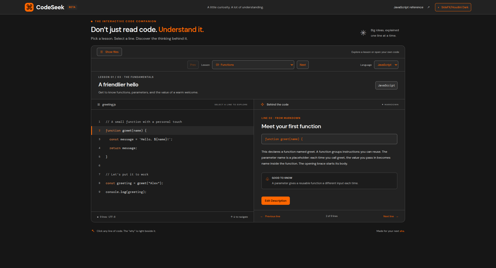

# CodeSeek

CodeSeek is a web-based coding tutorial companion. Select a code line on the left to read its explanation on the right. Code and explanations are stored in separate files, so you can create tutorials without changing the app.





## Run CodeSeek

From the project directory, run:

```sh
python3 server.py
```

Open [CodeSeek](http://localhost:8000) in your browser. Use the web server rather than opening `index.html` directly: the app fetches its lesson files. The included Python server discovers lesson catalogs automatically. No build step or package installation is needed. Choose a language, then use the Lesson dropdown or the Prev and Next buttons to browse its lessons. Google Fonts are optional; system fonts are used when unavailable.

## Appearance

Use **Dark mode** in the header to switch themes. CodeSeek follows your system theme until you choose one, then remembers your choice in this browser. Both themes cover the lesson viewer, file explorer, and description editor.

## Create a code/description pair

### 1. Create your code file

Create a folder for your tutorial and save a source file inside it. For example, create `my-tutorial/the_code_file.py` containing these four lines. Include the blank third line; do not add line numbers to the file.

```python
# A personal greeting
name = "Alex"

print(f"Hello, {name}!")
```

### 2. Create the adjacent Markdown file

In the **same folder**, create a file with the **complete code filename plus `.md`**:

```text
my-tutorial/
├── the_code_file.py
└── the_code_file.py.md
```

Keep the original extension. `the_code_file.md` will not pair with `the_code_file.py`. For JavaScript, use `example.js` and `example.js.md`. Names and letter case should match exactly.

Save both files as UTF-8 text. Local previews support files up to 2 MB each.

### 3. Write the explanations

Copy this complete example into `the_code_file.py.md`:

```markdown
# A personal greeting

Store a name and display a personalized message.

## Line 1: Describe the example

The hash sign starts a Python comment. This note tells the reader what the example does; Python does not execute it.

## Line 2: Remember a name

Assign the string `"Alex"` to `name`. The final line uses this value to build the greeting.

## Line 3: Separate the steps

This blank line separates the stored value from the output statement. It improves readability without changing the result.

## Line 4: Display the greeting

The f-string inserts `name` into the message. `print` displays `Hello, Alex!` followed by a newline.

### Good to know

The `f` before the opening quote enables value substitution inside braces.
```

The first `#` heading is the tutorial title. The introductory paragraph describes the file. Each `## Line N: Title` section supplies the explanation shown when the user selects source line `N`.

Use `### Good to know` after an explanation when you want an optional takeaway. Its contents belong to that line until the next `## Line N: Title` section.

### 4. Open and check the pair

1. In CodeSeek, click **Show files**, then **Choose another folder**. **Open folder** displays the app’s bundled `lessons/` directory directly in the explorer.
2. Select `my-tutorial` or a parent folder containing both files.
3. Expand the folder in the explorer and click **the_code_file.py**. Code files appear green; Markdown files appear orange.
4. The app automatically reads **the_code_file.py.md** beside it. Select each source line and check that its explanation appears on the right.

Select the **code file** to view the paired tutorial. Selecting the `.md` file itself displays its raw text. You do not need a catalog entry to open a pair through the folder explorer.

Files selected through the picker remain on your device. CodeSeek displays them read only and does not execute the code. To change a pair, edit it in your editor, then use **Choose another folder** again to select the updated files. Hiding the explorer keeps the current file open.

### Edit and version a description

Click **Edit Description** below the explanation to edit the full companion Markdown. The preview shows the currently selected source line. Invalid line numbers and duplicate sections display an error and prevent saving. **Cancel** leaves the current description unchanged.

Click **Save version** to apply your edits in the app and download a separate versioned file, for example `the_code_file.py.v001-2026-10-15T18-30-00-000Z.md`. Each save increments the version number for that document during the session and includes a UTC timestamp. The browser does not overwrite the original companion or write directly into the selected folder.

Edits remain available when switching between files or lessons during the session. After refreshing, reopen your saved version by placing a copy beside the code under its pairing name, such as `the_code_file.py.md`. Keep the numbered downloads as your version history. Version numbering starts again in a new session; timestamps distinguish those files. You can also use the editor to create a missing companion.

Click **Hide .md files** in the sidebar to hide Markdown entries from the folder tree. Their paired explanations still load when you select code. Click **Show .md files** to restore them. This choice remains active when you select another folder during the same session.

## Line numbering and Markdown rules

- Use one-based physical line numbers: the first source line is `Line 1`.
- Count comments, blank lines, imports, and closing delimiters. A statement spanning multiple source lines needs an explanation for each line; editor word wrapping does not add lines.
- Write one nonempty explanation for every source line, in ascending order. Use exactly `## Line N: A title`, with a single line number. Ranges such as `## Lines 1–3` are not supported.
- Do not repeat a line number or refer to a line beyond the end of the source.
- A final newline does not add an extra blank line. `a\n` has one line; `a\n\n` has two. An empty file is displayed as one blank line.
- After adding, removing, or moving source lines, update the Markdown line numbers and explanations to match.

The viewer supports paragraphs, inline code, bold, italics, bullet lists, headings, and triple-backtick fenced code blocks. Close every code fence. Literal examples of `## Line N: Title` headings must be inside code fences to avoid being interpreted as explanations.

This is a limited Markdown renderer. Avoid tables, images, links, YAML frontmatter, or advanced Markdown features in companions. Raw HTML is displayed as text.

A Markdown file containing only a title and introduction can provide a general description for all lines. For a full tutorial, write the individual line sections: when a section is missing, CodeSeek shows the introduction instead, if available.

## Generate a companion with an AI model

[Skill.md](Skill.md) contains reusable instructions for writing CodeSeek companions. Give the model that document and the complete source file. For example:

> Follow Skill.md to create my-tutorial/the_code_file.py.md for my-tutorial/the_code_file.py. Explain every physical source line, including comments and blank lines. Keep the source file unchanged and validate the line numbering.

If the model cannot access your files, supply their contents and save its Markdown output beside the source using the required name. Review the explanations for accuracy before sharing the tutorial.

## Language catalogs and automatic discovery

Each language folder has its own JSON catalog. There is no central `lessons/index.json`:

```text
lessons/
├── javascript/
│   ├── lessons.json
│   ├── greeting.js
│   └── greeting.js.md
├── python/
│   ├── lessons.json
│   ├── greeting.py
│   └── greeting.py.md
└── vex/                  # Optional local lessons; excluded from Git
    ├── lessons.json
    ├── helixCurve.vfl
    └── helixCurve.vfl.md
```

For example, `lessons/python/lessons.json` contains:

```json
{
  "language": "Python",
  "lessons": [
    {
      "tab": "Personal greeting",
      "source": "greeting.py",
      "initialLine": 2
    }
  ]
}
```

`language` names the language in the dropdown. `lessons` sets the lesson order. Each lesson has a `tab` title for the lesson dropdown and a `source` path **relative to that catalog’s language folder**. The companion path is obtained by appending `.md`. Optional `initialLine` selects the starting source line (default: 1). Titles and explanations remain in the Markdown companions.

To add a lesson, save its source and companion in the language folder and append an entry to that folder’s catalog. To add a language, create a new folder under `lessons/`, add its pairs, and add a catalog with the format above. Any `.json` filename works; use one catalog per language folder. Refresh the app to discover the changes. No app code or central list needs updating.

Run **`python3 server.py`**, then open [CodeSeek](http://localhost:8000). Use `python3 server.py --port 8001` for a different port. The server binds to your own computer and serves the project folder regardless of your shell’s working directory.

The `/api/lessons` endpoint scans `lessons/*/*.json` on each request and returns the available catalog paths in alphabetical order. The app loads those catalogs at startup and when opening the bundled lessons explorer. JavaScript and Python catalogs are tracked in Git; the local VEX catalog stays in the ignored VEX folder. A fresh checkout therefore includes only available JavaScript and Python lessons.

Browsers cannot enumerate server directories on their own. Opening `index.html` directly, the generic `python3 -m http.server`, or static hosting without the discovery endpoint will not discover catalogs. For hosting elsewhere, provide the same `/api/lessons` endpoint returning an array such as `["javascript/lessons.json", "python/lessons.json"]`. Local folder selection remains available if discovery fails.

## Troubleshooting

| What you see | What to check |
| --- | --- |
| No companion found | Both files are in the selected folder, next to each other, and named exactly `filename.ext` and `filename.ext.md`. |
| The wrong explanation | Count the current source lines, including comments and blanks, and update the matching Markdown headings. |
| A duplicate or out-of-range line error | Give each source line one unique heading numbered from 1 through the source-line count. The source remains viewable if its local companion is invalid. |
| The same introduction on several lines | Those lines have no individual sections. Add the corresponding `## Line N: Title` headings and explanations. |
| Edits are not visible | For local files, select the folder again. For built-in lessons, reselect the lesson; refresh after changing the catalog. |
| Built-in lessons fail to load | Start `python3 server.py` and check the language catalog paths and the presence of both files. |

Pairing uses the complete relative path: two subfolders may each contain `example.py`, and each uses its own adjacent `example.py.md`. The browser picker omits empty folders. On small screens, the code and explanation panels stack vertically.

## Verification

Before using a new pair, check that every source line has a matching, accurate explanation and that the original code has not been changed just to fit the guide. The app's parser rejects duplicate and out-of-range line references, but does not require every line to have an explanation.

Parser and built-in lesson tests use Node's built-in test runner, without dependencies:

```sh
node --test tests/*.test.mjs
python3 -m unittest discover -s tests -p "test_*.py"
```

## SideFX/Houdini colour modes

Use the header’s **SideFX/Houdini Light / Dark** button to switch modes. CodeSeek follows the system appearance until you choose a mode, then remembers your choice in this browser. Both palettes follow [the working colour guide](sidefx-houdini-colour-guide.md): neutral surfaces, shared `#FF6600` orange accents, Cool Gray 8 supporting graphics, and black text on orange actions. Light mode uses black text; dark mode uses white and light grey text on charcoal surfaces. The palettes cover lessons, file exploration, and the description editor.
